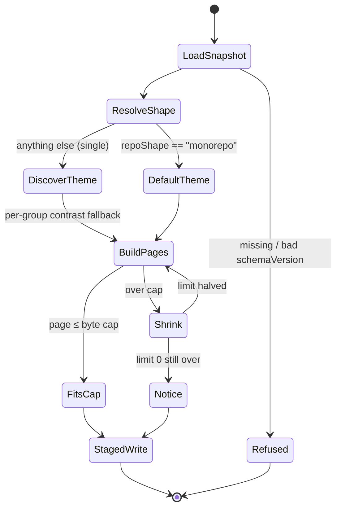

# Plan: state-report-redesign

**Pitch**: pitch.md  •  **Appetite**: big-batch (cap: 15 files, about 1,200 production LOC)  •  **Hill**: hill.md

**Baseline (2026-10-19)**: `state-html.test.mts` has 70 tests, `state-theme.test.mts` 18 and `state-snapshot.test.mts` 82. All 170 pass on Node 24.21.0.

`T` below stands for `node --experimental-strip-types --disable-warning=ExperimentalWarning --test`. There is no build, typecheck, lint or i18n command (`.project/context/stack.md`). The mandatory UI build step is therefore skipped, and the test suites and `setup-validator` stand in for it.

## Corrections to the pitch, found against the code

These come from reading the code. They change scope content, not appetite.

1. **The snapshot has no token totals and no model dimension.** `metricsSection` in `state-snapshot.mts` keeps only completion counts: `completions`, `reportedUsage`, `unavailable`, and `vendors[]` with per-vendor counts. A "token share by vendor/model" chart and "token totals" cards would need new facts, which is a no-go. They become **completions by vendor** (with reported and unreported usage) and a **completions** card with its reported-usage count. Real token totals belong to `state-deep-evidence`.
2. **The snapshot has no folder sizes.** The tree records directory names only. The "folder size" chart becomes **subfolders per top-level folder**, counted from `structure.tree`.
3. **The `workspaces` signal needs a content read, and a test pins that none happens.** `state-snapshot.test.mts` ("the tree scan reads no file contents") writes a marker into `package.json` and asserts it is never read. The detector adds one allow-listed, bounded read of the root `package.json` through `readSource`. That test is narrowed on purpose to allow exactly that file. A mutant read of any other file must still fail it.
4. **The CSP meta is not first in `<head>` today.** The order is charset, viewport, CSP (`state-render.mts` and `state-pages.mts` `shell`). S5 moves the CSP to be the first child. The charset meta stays inside the first 1,024 bytes, as the HTML specification requires.
5. **`render()` calls `discoverTheme(root, deps)`, but the signature is `(root, options, deps)`.** The injected deps land in `options`, so theme reads always use the default Node deps. S6 fixes the call while wiring the repo shape.
6. **The markup allow-list regex in `state-html.test.mts` matches only lowercase attribute names.** SVG `viewBox` would trip the "stray `<`" check. The S1 helper handles SVG tags and camelCase attributes.
7. **Ordering note.** The pitch names `state-ai-fragments` as the next part. It has since been split into `state-fragment-sanitizer` and `state-ai-authoring`. The slot names (`overview`, `architecture`, `history`, `risks`, `tokens`) match `state-ai-authoring`.

## Scopes

| ID | Name | Files | LOC est | Depends on | Parallel with | Subagent? | Dispatch model |
|----|------|-------|---------|------------|---------------|-----------|----------------|
| S1 | Extract the markup-agnostic invariants helper, then rewire the existing tests | `ai-framework/scripts/state-test-helpers.mts` (new), `ai-framework/scripts/state-html.test.mts` | ~120 test | — | — (runs first; short) | no: every later scope depends on it, and moving guard assertions without weakening them needs the parent's full context | — |
| S2 | Repo shape detector plus an additive `structure.repoShape` fact | `ai-framework/scripts/state-structure.mts`, `ai-framework/scripts/state-snapshot.mts`, `ai-framework/scripts/state-snapshot.test.mts` | ~95 prod, ~140 test | S1 | S3, S4, S5 | yes: its files are disjoint, it is self-contained (names plus one bounded read), and its exit is a clear fixture matrix | standard |
| S3 | Workflow default theme (replaces the zinc fallback); monorepo mode never scans | `ai-framework/scripts/state-theme.mts`, `ai-framework/scripts/state-theme.test.mts` | ~45 prod, ~80 test | S1 | S2, S4, S5 | yes: its files are disjoint, contrast is asserted by machine, and the palette rule is written down below | standard |
| S4 | Inline SVG chart module with a data-table fallback | `ai-framework/scripts/state-charts.mts` (new), `ai-framework/scripts/state-charts.test.mts` (new) | ~170 prod, ~130 test | S1 (imports the helper) | S2, S3, S5 | yes: a pure function from numbers to markup, with new files only | standard |
| S5 | Design system, shared shell (CSP first, sidebar, header) and page renderer rewrite | `ai-framework/scripts/state-design.mts` (new), `ai-framework/scripts/state-render.mts`, `ai-framework/scripts/state-pages.mts`, `ai-framework/scripts/state-html.test.mts` | ~280 prod new, ~±120 prod changed, ~150 test changed | S1 | S2, S3, S4 | no: this is the integration point. It rewrites the tests that pin markup and holds the byte-cap budget, so it is done inline in the main checkout | deep (inline) |
| S6 | Overview headline cards, chart wiring, empty AI slots, repo shape to theme wiring | `ai-framework/scripts/state-pages.mts`, `ai-framework/scripts/state-render.mts`, `ai-framework/scripts/state-html.test.mts` | ~130 prod, ~110 test | S2, S3, S4, S5 | — | no: it edits the same files as S5 and needs all four results merged | — |
| S7 | Integration doc and production LOC cap gate (cut charts to two if over) | `ai-framework/integrations/state-report.md` | ~45 doc | S6 | — | yes: a mechanical doc update plus counting, with a clear exit | fast |

**File count: 13 across scopes**: 7 production (`state-structure`, `state-snapshot`, `state-theme`, `state-charts`, `state-design`, `state-render`, `state-pages`), 5 test (`state-test-helpers`, `state-html.test`, `state-theme.test`, `state-snapshot.test`, `state-charts.test`) and 1 doc. `/ship` adds `CHANGELOG.md` and `VERSION` through `changelog.mts`, for **15 in total**. Production LOC is estimated at about 850, under the 1,200 cap.

**Blast radius: checked and left unchanged** (each has an exit check in S7):
- The `/state` skill and its mirrors (`.claude/`, `.agents/`, `.cursor/skills/state/SKILL.md`, `.opencode/commands/state.md`) stay untouched (critique A1). The skill's sentence "theme is rediscovered from the project's own CSS" goes stale in monorepo mode. The CLI preview line names the reason instead (S6), and a follow-up goes into `_followups.md` at `/ship`.
- `ai-framework/templates/project/reports/README.md` stays valid because the page names and file set do not change (`PAGE_NAMES` is the same). The instance copy `.project/reports/README.md` was already stale before this pitch and is local data, so it is out of scope.
- `workflow-doctor.mts` syntax-checks only CLI entry scripts. `state-pages` and `state-structure` are already absent from its list, so the new `state-design` and `state-charts` follow that precedent. `runtime/migrate.mts` `SCRIPT_NAMES` covers CLI entry names only, and no new entries are added.
- `bundle-sync.test.mts` checks that `.project/reports` survives sync, and the redesign does not touch it. `review-bench.mts` and `graphify.mts` only skip `.project/reports/`. `setup-validator.mts` has no reference to reports.
- No other script imports `state-render`, `state-pages`, `state-theme` or `state-structure`. Only the state modules and their tests do.

## Exit criteria per scope (machine-checkable, at least one per scope)

### S1: Invariants helper first, with production code untouched
Rules folded in: testing.md "Prove a guard test with an in-memory mutant", security.md §9.
- `ai-framework/scripts/state-test-helpers.mts` exports `assertInert`, `assertCspFirst`, `assertKnownMarkup`, `assertNavResolves` and `assertThemeContrast`. They check for no `<script>`, no `on*=`, `src=`, `action=` or `data=`, no external URL, no `url(`, `@import`, `filter`, `expression(` or `style=`, and no SVG `<style>`, `<use>`, `<image>`, `<foreignObject>` or `<animate>`. The tag and attribute allow-list includes SVG tags and camelCase attributes. Every `#id`, `aria-labelledby` and `*.html` link must resolve, ids must be unique, and every pair in `PAIRS` must be at least 4.5:1 in both modes.
- `T ai-framework/scripts/state-html.test.mts` exits 0 with **unchanged production code**: `git diff --quiet -- ai-framework/scripts/state-render.mts ai-framework/scripts/state-pages.mts` exits 0 when S1 completes. `assertCspFirst` is used from S5 onward, because the current markup fails it (correction 4).
- The test file includes "the invariant helpers reject each planted mutant", with one mutant per assertion: a script tag, an `onerror` attribute, `url(` inside SVG, a missing CSP, a broken anchor and a low-contrast pair. Each mutant must fail its assertion.
- `grep -c "function assertOnlyKnownMarkup" ai-framework/scripts/state-html.test.mts` returns 0, because the definition now lives in the helper only. `grep -c '^test(' ai-framework/scripts/state-html.test.mts` returns at least 71.

### S2: Repo shape detector
Rules folded in: security.md §9 ("one guarded reader"; bound input before regex), the pitch no-go "only additive `repoShape`".
- `T ai-framework/scripts/state-snapshot.test.mts` exits 0, and the suite includes a test named "repoShape fixture matrix". Precedence is fixed:
  1. Strong signals mean `monorepo`: root `pnpm-workspace.yaml`, root `lerna.json`, or `package.json` `workspaces` as a non-empty string array or as `{packages:[non-empty]}`.
  2. Otherwise, two or more sibling manifests mean `monorepo`. A sibling manifest is a `package.json`, `Cargo.toml`, `go.mod` or `pyproject.toml` at `{packages,apps,libs,services,modules}/<child>/`.
  3. `turbo.json` or `nx.json` alone means `single`.
  4. Anything ambiguous or unreadable means `single`.
- The matrix needs at least 15 cases, and every one must pass:
  - Each of these is `monorepo`: a workspaces array, workspaces `{packages}`, `pnpm-workspace.yaml`, `lerna.json`, `turbo.json` plus 2 siblings, and 2 siblings with no tool.
  - Each of these is `single`: workspaces `[]`, `"x"`, `{}` or `42`; `turbo.json` only; `nx.json` only; a single sibling; siblings under `templates/`, `fixtures/`, `examples/` or `test/`; a symlinked `package.json` or `pnpm-workspace.yaml`; a `package.json` over 64 KB (with a note); invalid JSON; an empty directory; this repository's own shape.
- Evidence is capped at 6 names, and the only content it carries is file names: `JSON.stringify(snapshot)` never contains a marker string planted in `package.json`. There is no upward walk: a `--root` at a package inside a monorepo reports `single`.
- In the narrowed "tree scan reads no file contents" test, the only allowed read outside `.project/` is the root `package.json`. An in-memory mutant that also reads `src/lib/code.ts` must fail the test.
- `grep -c "schemaVersion: 1" ai-framework/scripts/state-snapshot.mts` returns at least 1, so the snapshot version does not change. `grep -n "repoShape" ai-framework/scripts/state-structure.mts` matches.

### S3: Workflow default theme; monorepo never scans
Rules folded in: ui-ux-review.md H1 (status is never conveyed by color alone) and H4 (one consistent type scale), the decision `project-state-report-design` (`theme.json` is a record only).
- `FALLBACK` (the name is kept, so the exported-API pin in `state-theme.test.mts` stays unchanged) holds a deliberate workflow palette rather than plain zinc. Its rule: a neutral slate surface, one accent hue, and a system font stack with no web fonts. No new theme tokens are added, so `PAIRS` and the `Theme` schema stay the same.
- `T ai-framework/scripts/state-theme.test.mts` exits 0, including:
  - "monorepo never takes project tokens and never lists the tree". A fixture has a valid themed CSS file and `repoShape: "monorepo"`. A spied `fs` records zero `readdirEntriesSync` calls under the root and zero `.css` reads. The result has `light`/`dark` equal to `FALLBACK`, `sources: []`, and a `reason` naming the monorepo.
  - "every workflow default pair meets 4.5:1".
- `git diff -U0 ai-framework/scripts/state-theme.test.mts | grep -c '"FALLBACK", "MIN_CONTRAST"'` returns 0, so the line that pins the exported API is unchanged.
- `T ai-framework/scripts/state-html.test.mts` still exits 0 after the merge. If the fixture in the test "clashing background sends the whole mode to fallback" stops clashing with the new accent, its colors are re-picked so the background still clashes. The assertion is never loosened.

### S4: Chart module
Rules folded in: the pattern "allow-list untrusted labels at ingest and at render", the pitch's critique S3, security.md §9.
- `T ai-framework/scripts/state-charts.test.mts` exits 0 and covers:
  - `barChart({ id, title, rows })` accepts a chart `id` only from a fixed constant set; anything else throws.
  - Values must be non-negative safe integers. Other rows are dropped and counted in a visible note.
  - Labels are matched against `^[A-Za-z0-9 ._/-]{1,40}$`, truncated to 24 characters and escaped. Labels that fail the pattern become `other`.
  - At most 8 bars are drawn, and the remainder becomes "other (N more)".
  - Empty input or all zeros renders an `unavailable` chip and no `<svg>`.
- The test output passes `assertInert` and `assertKnownMarkup`. A planted mutant that emits `style="` or `url(` fails it.
- Geometry uses presentation attributes only. Color comes from a `class` on each mark, styled by the page `<style>`, so there is no `fill="#…"` copied from data. `grep -nE "url\\(|filter|<style|style=" ai-framework/scripts/state-charts.mts` returns no match outside comments.
- Every chart has `<title>` and `<desc>` referenced by `aria-labelledby`, plus a `<table>` with a `<caption>` whose row count equals the bar count. A 500-row input produces at most 9 bars and at most 4,096 bytes. Rendering is deterministic: two calls give byte-equal output.

### S5: Design system and shell
Rules folded in: ui-ux-review.md (touch targets ≥44px, visible focus, consistent layout across pages), the pitch no-gos (no script, external load or web font), performance.md (no client-side JavaScript).
- `ai-framework/scripts/state-design.mts` holds the only stylesheet string and the only `shell()`:
  - Tokens come from `safeTheme`, with the type scale and spacing as CSS variables.
  - Layout pieces: a sidebar, a header (project name, workflow version, generated time), cards, and status chips that pair text with a distinct border style.
  - Responsive: the sidebar stacks above the content at 640px or narrower.
  - Print: the sidebar is hidden.
  - Dark mode follows `prefers-color-scheme`.
  - `state-render.mts` and `state-pages.mts` contain no `<head>` markup of their own: `grep -c "<head>" ai-framework/scripts/state-render.mts ai-framework/scripts/state-pages.mts` returns 0 for both.
- `T ai-framework/scripts/state-html.test.mts` exits 0. All 7 pages pass `assertCspFirst`, `assertInert`, `assertKnownMarkup` and `assertNavResolves`. Every page has exactly one `aria-current="page"` in the sidebar. `state.html` has its own "Page sections" nav with a distinct `aria-label`. Test assertions that pinned old markup are rewritten to the new markup **after** the helper calls are in place, and anchor-count checks account for sidebar links appearing on every page.
- The shell with an empty body is at most 10,240 bytes (a new test), so the 12 KB `state.html` notice test still passes. The byte-cap tests (20, 30, 40 and 60 KB) all pass unchanged.
- The stylesheet contains `@media (max-width:640px)`, `@media print`, `prefers-color-scheme:dark`, `:focus-visible` and `min-height:44px` on sidebar links (each checked by an assertion).
- `grep -c '^test(' ai-framework/scripts/state-html.test.mts` returns at least the S1 count.

### S6: Overview, charts, slots and the repo shape to theme wiring
Rules folded in: the pitch no-go "no new facts", security.md §9 (`state.json` is untrusted input).
- `index.html` shows headline cards, each of which is a value or an `unavailable` chip and never a guessed 0:
  - active pitches, counted from `pitches.items` with phase `active`
  - shipped, counted from `shipped` plus `compacted`
  - knowledge entries (`knowledge.value.entries`)
  - completions and how many reported usage (`metrics.value`)
  - sync attention (`workflow.partialSync.value.state`)
- Charts are wired in as follows. `T ai-framework/scripts/state-html.test.mts` exits 0, with a test that renders every page with each chart's source missing or hostile.
  - completions by vendor goes on metrics and the overview
  - pitches by phase goes on pitches and the overview
  - knowledge by type goes on knowledge
  - subfolders per top-level folder goes on structure
- `SLOT_NAMES` is exactly `overview`, `architecture`, `history`, `risks`, `tokens`. With no fragments, a slot emits an empty string. The test asserts that a page does not change byte-for-byte whether slot calls are present or stubbed, and that no slot appears before the CSP meta.
- Render reads `snapshot.structure.repoShape.value` and treats only the exact string `"monorepo"` as monorepo. Any other value, a missing value or a hostile one means `single`, so a hostile `state.json` can at most force the safe default theme. It calls `discoverTheme(root, { repoShape }, deps)`, which fixes correction 5. Tests cover:
  - Under a monorepo snapshot, a project CSS file is never read (spied injected deps).
  - Under a hostile `repoShape`, the theme comes from discovery.
  - `theme.json` records `repoShape`.
  - The CLI preview line names `monorepo` and the workflow default theme.
- `T ai-framework/scripts/state-html.test.mts ai-framework/scripts/state-theme.test.mts ai-framework/scripts/state-snapshot.test.mts ai-framework/scripts/state-charts.test.mts` exits 0, with at least 170 tests passing (no regression from the baseline).

### S7: Doc and cap gate
- `ai-framework/integrations/state-report.md`:
  - `grep -c "repoShape" ai-framework/integrations/state-report.md` returns at least 2.
  - `grep -c "zinc" ai-framework/integrations/state-report.md` returns 0.
  - The Theme section states that a monorepo always uses the workflow default theme and is never scanned, and gives the precedence order.
- Production LOC cap: `git add -N ai-framework/scripts/state-charts.mts ai-framework/scripts/state-design.mts && git diff --numstat $(git merge-base HEAD main) -- ai-framework/scripts/state-{structure,snapshot,theme,charts,design,render,pages}.mts | awk '{a+=$1} END {print a; exit (a>1200)}'` exits 0. If it exits 1, cut to two charts (completions by vendor, pitches by phase), remove the other two from `state-charts.mts` and `state-pages.mts`, log the cut in the deviations log, and rerun the check.
- The skills stay untouched: `git diff --quiet $(git merge-base HEAD main) -- .claude/skills .agents/skills .cursor/skills .opencode/commands` exits 0.
- The template README is still valid: every page in `PAGE_NAMES` appears in it. `for p in index structure skills metrics knowledge pitches; do grep -q "$p.html" ai-framework/templates/project/reports/README.md || exit 1; done` exits 0.
- `node ai-framework/scripts/setup-validator.mts` exits 0.
- At most 13 files changed outside `.project/`: `git diff --name-only $(git merge-base HEAD main) | grep -v '^\.project/' | wc -l` (the new files are counted through `git add -N`).

## Risks (inherited from pitch rabbit holes)

| Risk | Scope | Spike needed? | Mitigation |
|------|-------|---------------|------------|
| The workflow default palette and type get invented ad hoc (pitch owner S1) | S3 | no | Palette rule stated in S3 (slate neutrals, one accent, system fonts). Every pair is asserted at 4.5:1 or above. The design is reviewed against `ui-ux-review.md` H1 and H4 by the `/audit` ux-reviewer. No new tokens. |
| Tests in `state-html.test.mts` pin the current markup (pitch owner S2) | S1, S5 | no | S1 extracts the invariants first and must pass on unchanged production code. S5 rewrites only the markup pins, after the helper calls are in place. The test count may not drop. |
| Chart labels and key counts grow on large projects (pitch owner S3) | S4 | no | At most 8 bars plus "other (N more)". Labels are allow-listed and cut to 24 characters. The chart is at most 4 KB, and its size counts inside the page byte-cap loop. |
| Theme root per `repoShape` (critique S1): the depth-6, 200-file scan mixes package themes | S3, S6 | no | Monorepo mode never calls `collect()`. This is asserted with a spied fs (zero tree listings, zero `.css` reads). |
| Detection edge cases (critique S2): workspaces shapes, lone `turbo.json`/`nx.json`, fixture siblings, nested root | S2 | no | Fixed precedence, ties resolve to `single`, evidence capped at 6, no upward walk, and a 15-case fixture matrix as the exit. |
| CSP and charts (critique S3): a meta CSP applies only to content after it; SVG styling could reach `url()` | S4, S5 | no | The CSP is the first `<head>` child (`assertCspFirst` on all 7 pages). Charts use presentation attributes plus classes, with no `style=`, `url()`, `filter` or SVG `<style>`, and a mutant proves the check. |
| Test churn weakens guards (critique S4); sidebar links inflate anchor counts | S1, S5 | no | Helper first, mutant-proven. Anchor checks are rewritten to be per-nav. |
| Cap accounting (critique A1, A2): skills or mirrors touched; charts push production LOC over the cap | S7 | no | `git diff --quiet` on the skill directories. A numstat LOC gate, with a cut to two charts if it fails. |
| Ordering (cross-pitch X4, X9): token cards and the `token-attribution` reader; `workflow-v3-rollout` dry run | S6 | no | The cards read only the existing `metricsSection` (token snapshot v1/v2). If `token-attribution` ships v3 first, the cards show `unavailable` (honest) until that pitch extends the reader. No second reader is written. The rollout dry run is re-run after `/ship`. |
| New: the `workspaces` read loosens the pinned "no content reads" guard | S2 | no | A single allow-listed root `package.json` read through `readSource` (symlink-refusing, size-bounded, at most 64 KB). Only the shape is checked; nothing is copied. A mutant read of another file still fails. |
| New: `repoShape` is read from untrusted `state.json` | S6 | no | Only the exact value `"monorepo"` selects the default theme. A hostile value can at most force the safe built-in theme. |
| New: the richer shell CSS and sidebar break the 12 KB notice-page test and the small-cap tests | S5 | no | Shell budget of 10,240 bytes, asserted. Charts are built inside the byte-cap loop. |
| New: changing `FALLBACK` invalidates the "clashing background" fixture | S3, S5 | no | Re-pick the fixture colors so they still clash. Never loosen the assertion. |
| New: the `/state` skill text ("theme rediscovered every run") goes stale in monorepo mode while skills are frozen | S6 | no | The CLI preview names the monorepo reason. A follow-up is logged at `/ship`. |

## Parallel dispatch plan

- **Wave 1 (inline, sequential):** S1, by the parent at the standard profile. It is a blocker for everyone, and the base must be committed before the worktrees fork.
- **Wave 2 (parallel):** S2, S3 and S4 go to subagents at the standard profile, **each in its own isolated worktree** (no parallel writers in one checkout, per harnesses.md "Sub-agent Dispatch"). At the same time, S5 runs inline in the main checkout at the deep profile. The file sets are disjoint: S5 owns `state-html.test.mts` from this point on, and the subagents must not edit it. Each subagent returns its diff plus the output of its exit command.
- **Merge gate:** merge S2, S3 and S4 into the main checkout, then rerun `T` on all four state test files. Resolve the S3 palette against the S5 fixtures here.
- **Wave 3 (inline):** S6, standard profile. It needs every earlier result.
- **Wave 4:** S7 goes to a subagent at the fast profile (doc plus counting). The parent re-runs the LOC gate and `setup-validator` itself before calling the scope done.
- Fallback when a harness has no nested dispatch: run S2, then S3, then S4 sequentially, with the same exits.

## Wireframes (UI scopes only, light)

Overview page (`index.html`) at 640px or wider. Below 640px the sidebar becomes a wrapped link list above the header.

```
┌─ index.html ─────────────────────────────────────────────────────────┐
│ ┌─ nav "Report pages" ─┐ ┌─ header ─────────────────────────────────┐│
│ │ ▸ Overview (current) │ │ <h1> Project name                        ││
│ │   Structure          │ │ workflow 2.32.1 · generated 2026-10-19   ││
│ │   Skills             │ │ 41 observed · 3 stale · 2 unavailable    ││
│ │   Metrics            │ └──────────────────────────────────────────┘│
│ │   Knowledge          │ ┌─ main ───────────────────────────────────┐│
│ │   Pitches            │ │ [slot: overview — empty in this pitch]   ││
│ │   Full report        │ │ ┌card────┐┌card────┐┌card────┐┌card─────┐││
│ │                      │ │ │Active 2││Shipped ││Knowl. 84││Sync     │││
│ │ (links ≥44px tall,   │ │ │pitches ││  31    ││entries  ││clean    │││
│ │  hidden in print)    │ │ └────────┘└────────┘└─────────┘└─────────┘││
│ └──────────────────────┘ │ ┌card: Completions 120 · 96 reported ───┐││
│                          │ └───────────────────────────────────────┘││
│                          │ <h2> Pitches by phase   [bar SVG]        ││
│                          │      ▸ Data table (caption, same rows)   ││
│                          │ <h2> Completions by vendor [bar SVG]     ││
│                          │ <h2> Project  (fact table + evidence)    ││
│                          │ <h2> Legend   (status chips + meaning)   ││
│                          └──────────────────────────────────────────┘│
└──────────────────────────────────────────────────────────────────────┘
```

Render state (static output, no JavaScript):



## Living-spec deviations log

(Empty at /plan time. /build appends here as the work diverges from this plan.)

### Deviations logged during /build (2026-10-19)

1. **Chart layout**: S4's vertical bars let 24-character labels overlap at 8 bars; `renderSvg` is now horizontal (label left, bar, value). Exits unchanged (17 chart tests pass).
2. **S2 applied by `git apply`, not Orca reconcile**: another session held uncommitted edits in `state-snapshot.test.mts` (`apply:dirty-overlap`). The S2 patch was reviewed and applied by hand; S3 and S4 went through reconcile. That session's commit `cf8ecfe` later swept the S2 test and the `state-report.md` edits into it. Content is intact, attribution is mixed.
3. **S7 ran inline, not on a fast worker**: `state-report.md` was already dirty from the other session, which an isolated worktree plus reconcile would have refused.
4. **S7 gate baselines**: `git merge-base HEAD main` is far behind this branch, so the skills-untouched and file-count gates were measured against `633adb3` (the commit before this pitch). Result: skills diff exit 0; 12 files changed by this pitch outside `.project/` (13 cap). Production LOC added: 414 (cap 1,200).
5. **`state-test-helpers.mts` runtime boundary**: S1 imported `node:assert`, which `workflow-doctor` fails in a non-`.test` file. Rewritten to plain throws; doctor is READY WITH WARNINGS, `setup-validator` exit 0.
6. **UX 5-question check**: 1) overview has 3 sections above the fold (cards, two charts) plus tables below: OK. 2) no decision UI. 3) 640px: sidebar stacks, tables scroll inside `.scroll`, chart svg `max-width:100%`: asserted by stylesheet test, not viewed in a browser. 4) detail tables follow the charts; trees fold at 8. 5) all colors are theme tokens; the only hex are in the print block.
