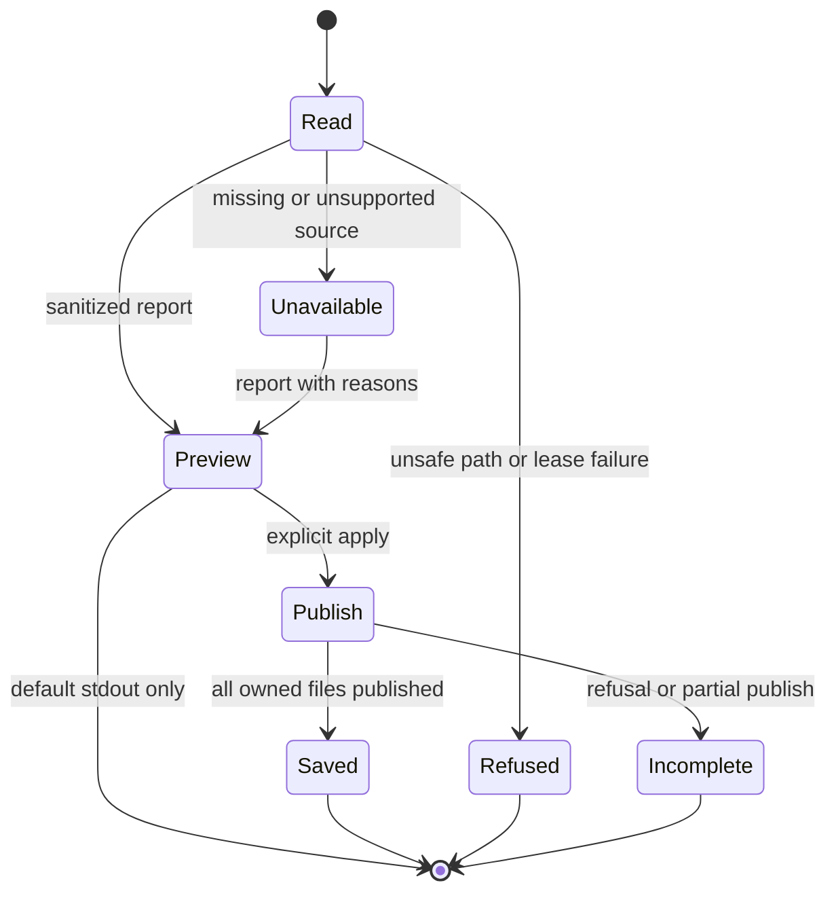

# Plan: token-time-report

**Pitch**: pitch.md • **Appetite**: big-batch • **Hill**: hill.md
**Status**: approved by owner, 2026-10-21 (“Approve”); impact acknowledged. Build start approved by owner on 2026-10-21 (“Approve”).
**Budget**: 6 new + 5 modified files; about 1,300 changed lines including tests/docs/release, hard cap 15 files / 1,500 LOC / one week. Estimates are not implementation measurements.

## Scopes

Paths below are relative to `ai-framework/scripts/` unless stated otherwise. Release metadata belongs to ship, not an early version bump.

| ID | Name | Files | LOC est | Depends on | Parallel with | Subagent? | Dispatch model |
|----|------|-------|---------|------------|---------------|-----------|----------------|
| S1 | Read-only joined JSON report | new flow-join.mts, flow-join.test.mts, flow-report.mts, flow-report.test.mts | 700 | — | — | yes; self-contained JSON CLI, four owned files and explicit tests | standard; configured Claude Sonnet |
| S2 | Markdown/HTML and owned publication | new flow-render.mts, flow-render.test.mts; extend flow-report.mts and its test | 500 | S1 | — | yes; sequential ownership transfer after S1 settles | standard; configured Claude Sonnet |
| S3 | State link and portable contract | modify state-pages.mts, state-html.test.mts, ../integrations/workflow-metrics.md; VERSION/CHANGELOG.md at ship | 96 | S2 | — | no; coordinator handles small integration and release serialization | — |

Each scope leaves a usable result: S1 previews joined JSON, S2 exports three formats, S3 exposes the existing report from /state and documents the contract. S1's temporary JSON-only delivery is an implementation slice, not a reduction of the approved final scope.

## Interfaces and decisions pinned before build

- `flow-join.mts` owns minimal typed source/report interfaces, projection validation and pure joining. Treat all disk values as unknown until validated. It imports no filesystem or CLI code. Renderer consumes only the sanitized report model. CLI imports joiner/renderer and RuntimeDeps; no reverse imports.
- CLI: `node ai-framework/scripts/flow-report.mts --root <project> [--format json|markdown|html | --apply]`. Default format JSON; no apply means stdout preview only. Apply publishes all three fixed report names and prints a publication summary; --format and --apply are mutually exclusive. No arbitrary destination or shell command argument. Unknown flags exit 2; unsafe path, lease failure or refused publication exits 1. A successfully rendered report with missing/unsupported sources exits 0 and carries unavailable statuses.
- Read token-consumption.json and workflow-usage.json under exactly one `withMetricsLease` acquisition using its guarded dependencies. Reuse exported `metricsDirectory(root,false)`, `readText` and `readWorkflowState` unchanged. Never call recordEvent, recordWorkflowEvent or a writer to read. No metrics directory is created during preview.
- Token projection requires schemaVersion=3, bounded flows, valid timestamps, nonnegative safe numeric counts and reporting-count consistency. Copy only needed fields; reject invalid projection without echoing values. Usage schema 2 uses its existing reader; in-memory v1 compatibility remains legacy/unjoinable and never rewrites the file. Unsupported input is unavailable, not an empty valid source.
- Join keys use exact pitch slug, pipeline phase and scope. Match the resolver's existing grammar (`^[a-z0-9][a-z0-9-]{0,79}$`, the 12 phases in token-consumption.mts, and `S` plus 1–3 digits or `(none)`). No current-directory existence check: moved/shipped pitches retain their identity. Never re-resolve a historical key from a live pointer. `(other)`, `(unknown)`, `(unattributed)` and noncanonical legacy keys remain source-specific unjoinable rows.
- Preserve token-only and timing-only rows. Vendor rows carry tokens, completions, reported and unavailable counts. No reported usage means tokens=null; some usage means a partial sum with coverage. Checked arithmetic refuses an overflowing aggregate. No estimated usage. Label vendor completion units from the existing contract; differing units are not ranked as equivalent work.
- Pitch/phase/scope token rollups may sum disjoint token leaves once. Timing rollups use their stored rows, never sums of children or vendor copies. Use only settled activeMs/waitMs. Show global pending and buffered interval counts; label timing provisional while intervals remain. Do not advance the frontier, extrapolate to now, or mutate/fold state in the report.
- Source metadata includes status, since, updatedAt, fixed reason and coverage/health. More than seven days old is stale. Different observation windows remain explicit; no efficiency ratios. Effort, cache-hit and output/input ratios are unavailable with fixed reasons. Wait is a lower bound of elapsed time between turns, not necessarily think-time.
- Pitch transitions/trace come from usage.pitches, not inference from chat. Preserve transition classes and at most the existing 32 trace entries. Scope/phase failures are not synthesized from pitch-level summary outcomes.
- Optional history reads only `.project/reports/state.json`, outside the metrics lease, with separately pinned project/reports ancestry and guarded read. Validate schema 1, generatedAt, history.items Fact rows and nested availability. Join by exact slug, preserve per-field partial/unavailable states, disclose snapshot age and history limits. A missing slug in a truncated snapshot is unavailable, not zero/not-shipped. Never invoke snapshot generation or parse pitch/audit records.
- Bound source bytes to 4 MiB each, history to 4 MiB; projection traversal to 51 pitch buckets, 16 phases per pitch, 26 scopes per phase and 600 token vendor leaves per source. Over-limit projections are refused. Output keeps at most 100 joined leaf rows plus their displayed ancestors in stable lexical order, with explicit omitted counts. Full validated source totals remain separate from displayed-row totals. Bound each output to 4 MiB; if exceeded, refuse publication with a fixed reason rather than writing a partial file.
- All label-keyed storage uses Map/null-prototype maps. Validate identifiers and scrub credential-shaped values before every format, including JSON metadata and reason text. Never print rejected raw values, internal session IDs, pending identifiers, prompts or transcript contents.

## Exit criteria per scope

Commands listed here are build-time requirements, not checks already run. Tests live beside source and use shared RuntimeDeps helpers. Node is the full-suite authority; Bun covers changed modules as the supported alternate runtime.

### S1 — snapshot and join

`node ai-framework/scripts/run-tests.mts --runtime node ai-framework/scripts/flow-join.test.mts ai-framework/scripts/flow-report.test.mts` exits 0.

Behavior cases must prove:
- Exact three-component match, `(none)` match, every sentinel refused as identity, canonical legacy mismatch, token-only and time-only rows; a pitch folded only in one store remains unmatched with separate overflow totals.
- Partial/unreported tokens, safe-integer overflow, prototype keys, invalid dates/versions, missing/refused/oversized/FIFO/symlink sources, stale history, truncated missing history, unequal observation windows and stable output caps.
- Overlapping child timing is never added into a parent; buffered and pending activity stays provisional without fabricated elapsed time. Duplicate vendor token rows do not duplicate timing.
- One lease acquisition, no nested acquisition, no source writes, no preview filesystem changes, lease release on refusal, legacy lock refusal; directory swap injected during acquisition leaves outside files unchanged. Fake the lease dependencies rather than bind a live port.
- Importing the CLI has no side effect; preview emits parseable sanitized JSON. No `any`-equivalent validators.

### S2 — three formats and publication

`node ai-framework/scripts/run-tests.mts --runtime node ai-framework/scripts/flow-render.test.mts ai-framework/scripts/flow-report.test.mts ai-framework/scripts/flow-join.test.mts` exits 0.

Behavior/artifact checks (the UI build equivalent for this package-less static report):
- All three formats expose the same sanitized report semantics, units and coverage; no untrusted identifiers or credential-shaped fixtures survive any output.
- HTML is standalone, inert, CSP-protected and keyboard-readable, with semantic table captions/headers and scrollable wide tables. No script, external resource or active user-supplied link. Markdown escapes cells and link syntax.
- Preview never writes. Apply reads once, renders outside the metrics lease, then uses an exclusive publication staging directory with pinned ancestry. No second metrics lease. Existing generated filenames require the format's generator marker/schema identifier; unmarked files, symlinks, FIFOs and directories are refused and preserved.
- Recheck destination identity/content metadata immediately before publish. A new target uses exclusive publication; clean up only owned staging files. Concurrent apply and injected parent/target swaps preserve user/outside files and allow a later safe retry.
- A failed multi-file publication is reported as incomplete and never described as an atomic set. Each generated file carries the same report generation ID so mixed generations are detectable; readers see complete files. Input snapshots remain byte-identical.
- Guard tests include an in-memory mutant proving the ownership and ancestor-swap tests fail for the intended reason.

### S3 — state integration and contract

`node ai-framework/scripts/run-tests.mts --runtime node ai-framework/scripts/state-html.test.mts ai-framework/scripts/state-snapshot.test.mts ai-framework/scripts/flow-report.test.mts ai-framework/scripts/flow-render.test.mts` exits 0.

- Add the fixed flow-report.html link through state-pages' existing safe link helper. Existing report links remain. No target gives an unavailable line; unsafe target never becomes a link. Rendering /state never invokes or refreshes flow-report.
- Static HTML artifact checks exercise present, missing and unsafe report targets and existing page navigation/CSP. No app build/typecheck/lint exists; do not invent one.
- Contract documents commands, units, nulls, capture windows, pending timing, source refusal, bounds, ownership and partial publication recovery. No changes to the /state AI tokens slot or collector APIs.
- `node ai-framework/scripts/setup-validator.mts` and `node ai-framework/scripts/graphify.mts --check` exit 0. At final build/audit verification, `node ai-framework/scripts/run-tests.mts --runtime node` passes; `node ai-framework/scripts/run-tests.mts --runtime bun ai-framework/scripts/flow-join.test.mts ai-framework/scripts/flow-report.test.mts ai-framework/scripts/flow-render.test.mts ai-framework/scripts/state-html.test.mts` passes. Missing Bun is a prerequisite failure to resolve, not a waived check.
- VERSION and CHANGELOG are updated only during approved ship through the changelog skill/script against then-current release state; do not choose a version now.

## Impact analysis — acknowledgment required

**Risk: medium**, concentrated in read/publish path safety and truthful timing/coverage. No schema or collector changes. Six new files and five modified files include release metadata; workflow artifacts are administrative.

| Modified file | Downstream consumers | Checks / risk |
|---|---|---|
| state-pages.mts | state-render.mts directly; /state output and state-html tests indirectly | state-html.test.mts and state-snapshot.test.mts; additive link only |
| state-html.test.mts | Test runner discovery | Existing artifact and navigation coverage retained |
| integrations/workflow-metrics.md | Developers and receiving-project bundle sync | Contract must match commands and status semantics |
| VERSION / CHANGELOG.md | changelog tooling, workflow version reports, future release work | Serialize at ship; VERSION is not automatically synced to receiving projects |

Unchanged dependencies reused: workflow-metrics-state.mts (`metricsDirectory`, `readText`, `readWorkflowState`, `withMetricsLease`); runtime/entry.mts, runtime/cli.mts and RuntimeDeps. Their caller semantics remain unchanged. New report imports flow inward: CLI to pure join/render and existing runtime helpers. No barrel or API changes, external packages or boundary violations planned.

Knowledge alerts inherited: missing versus refused, directory identities across leases, generated-file ownership, prototype keys, output scrubbing, independent cap folds. The graph was queried before targeted consumer searches. No knowledge entries changed.

Cross-pitch: workflow-v3-rollout operates in receiving repositories; this plan neither edits those repositories nor chooses its base snapshot. Recheck release-file contention at audit/ship. OpenCode model pinning remains unsupported by the inspected runtime; use configured Claude alternate rather than retry that route.

## Risks

| Risk | Scope | Spike needed? | Mitigation |
|------|-------|---------------|------------|
| Private token reader cannot be imported | S1 | no; source checked | Reuse public byte reader; validate a minimal flow projection locally; no collector extraction |
| Stored intervals omit buffered time | S1 | no | Settled totals only, pending/buffered counts, explicit provisional status |
| Stale/truncated optional history | S1 | no | Independent guarded read and per-field unavailable states; no raw record parser |
| Two apply processes or ancestor swaps | S2 | no; injected tests required | Pinned exclusive staging, ownership check, publish reinspection, fail closed |
| Three output files are not an atomic set | S2 | no | Generation ID and explicit incomplete result; no false transaction claim |
| Appetite may grow with security cases | all | plan/build checkpoint | Target about 1,300 LOC; stop before 1,500 LOC/15 files; propose JSON report then presentation as separate pitches if needed |
| Sparse capture does not represent adoption | all | no | Synthetic boundary evidence plus labeled live smoke; no complete-coverage claim |

## Parallel dispatch plan

1. No implementation dispatch during planning. After plan approval and the big-batch build-start gate, inspect the bound Orca Run. The shape Run objective explicitly covers pre-bet review only; do not silently reuse it for implementation. Bind a suitable build Run under the coordinator protocol.
2. Dispatch S1 to configured Claude standard profile (`claude-sonnet-5-5`); collect its own worker_done, independently inspect diff and rerun exits. Do not include .project paths in implementation filesModified.
3. After S1 is settled, transfer its two CLI files to S2's worker. Dispatch S2 at standard profile; shared CLI ownership prohibits parallel execution.
4. Coordinator performs S3 after S2 evidence. There is no safe scope fan-out in this bounded plan. Mandatory audit fan-out occurs in /audit under its own skill.
5. Big-batch scope gates remain active; never auto-advance past a scope confirmation.

## Wireframe (static report, light)

```text
Flow report | generated timestamp | source status and observation windows
Coverage: tokens reported / completions | active ms | wait ms (lower bound)
Pitch > phase > scope rows | vendor tokens | attribution/overflow gaps
Pitch transition counts and bounded trace
History evidence | unavailable metrics and reasons | limits/provisional notes
```



No UI framework, component skeleton, AI-prompt scope or golden model eval applies. Artifact/behavior tests cover this static report.

## Living-spec deviations log

S1/S2 dispositions are in deviations.md: usage reader bounds 52/18; explicit preview/apply modes and static-report UX exceptions. Actual S1+S2 size is 1,360 lines, whole-pitch projection 1,456. No appetite increase approved.

## Confirmation gate

Owner selected **Approve** on 2026-10-21. Plan finalized and impact acknowledged. The owner separately approved build start on 2026-10-21; S1 execution begins under Run `run_3de93fe9dd4a`.

## Test strategy carried from approved exits

This table organizes the already approved behavior checks; it does not replace them. Tests use Node test with RuntimeDeps injection and shared fixture helpers, not implementation snapshots.

| Source | Critical behavior / edge case | Type | Test file |
|---|---|---|---|
| flow-join.mts | Exact joins and nonadditive time; sentinel/overflow/partial data | Unit | flow-join.test.mts |
| flow-report.mts | Single guarded snapshot and no writes in preview; lease/path/input refusal | Integration | flow-report.test.mts |
| flow-render.mts | Equivalent sanitized semantics across formats; hostile labels and output cap | Unit/artifact | flow-render.test.mts |
| flow-report.mts publication | Owned files only; concurrent publish and directory/target swap | Integration with injected scheduling | flow-report.test.mts |
| state-pages.mts | Existing flow-report link only; missing/unsafe target and no generation | Artifact integration | state-html.test.mts |

Test-strategy coverage checks at scope completion: utilities target ≥90%; orchestration target ≥80%. Use run-tests.mts --coverage for the scoped Node tests and inspect per-file evidence; coverage is supplementary to the explicit behavior cases. No browser E2E, frontend build or framework render test is needed for this static report.

## Build verification rollup

S1, S2 and S3 are done with current-session evidence in S1-evidence.md, S2-evidence.md and S3-evidence.md. Final Node full suite: 2469 pass, 0 fail, 3 existing skips; scoped Node 207 and Bun 120 pass. The first full attempt's geometry timing failure and clean retry are retained in log.md. Implementation/test/contract count is 1427 changed lines across nine files; release metadata is reserved for ship. Await owner approval of the final scope and build-end gate before audit.

## Cohesive module size exception — audit addendum, 2026-10-21

This records the existing implementation structure, without changing its behavior or appetite. The generic 80-line utility limit is exceeded by these cohesive units:

- `ai-framework/scripts/flow-join.mts` (322 lines): one bounded projection/join transaction shares typed source status, exact/source-specific identity, checked accumulators, omission counts and the single FlowReport output. Splitting per source/type would distribute the bounds and identity proof across extra modules without an independent consumer.
- `ai-framework/scripts/flow-report.mts` (223 lines): one guarded read/publication transaction shares pinned directories, target and stage identities, cleanup ownership and incomplete-publication accounting. Splitting per filesystem operation would fragment its recovery path and make identity checks harder to audit together.
- `ai-framework/scripts/flow-render.mts` (122 lines): one shared table model feeds all three formats, preserving status/window/timing semantics with format-specific escaping and ownership markers. Splitting per table/format would duplicate or hide that common proof surface.

The alternative of mechanical per-function/per-type extraction was considered and rejected for these reasons; no concrete shared consumer justifies it. The independent code reviewer accepted the substantive cohesion rationale and requested this ownership record in both plan.md and deviations.md. Security, testing and the hard 15-file/1,500-line cap remain binding; actual implementation/test/contract size is 1,479 lines across 11 files.
