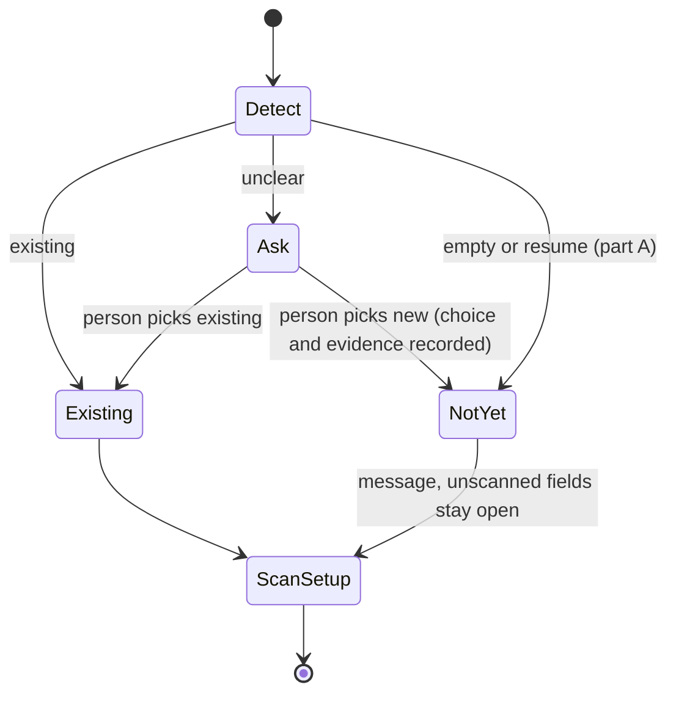

# Plan: greenfield-kickoff

**Pitch**: [pitch.md](pitch.md)  •  **Appetite**: big-batch, split into part A (this plan) and part B (planned after A ships)  •  **Hill**: [hill.md](hill.md)

Drafted and approved by the owner on 2026-11-27 (part A).

## Split decision

The pitch splits itself when `/plan` counts more than 15 files or 1,500 lines. The count below passes both limits, so the split trigger applies.

| Count | Pitch estimate | Planned count |
|---|---|---|
| Files | 15 | About 20. The pitch omitted `VERSION`, `CHANGELOG.md`, `ai-framework/docs/setup.md`, and code for the publication rules that two test-bound cases require (below). |
| Lines | At or slightly over 1,500 | About 2,000. Part A is about 900 lines and part B about 1,100. These are judgments, not measurements. |

- **Part A (this plan): detection, routing and definition ownership.** It ships on its own. An empty project is reported as empty, an unclear one asks the person, and `/setup` stops claiming conventions it could not scan for.
- **Part B (outline only): interview and hand-over.** It includes the `kickoff` skill and three adapters, the definition template, the draft and publication rules, the `first-version` hand-over, `relations.toon` and the ten remaining golden cases. Plan it after A ships, against A's real detector output.

## Entry condition (before `/build` of part A)

**The install-identity bug must ship first.** Evidence: `_followups.md`, "New installs inherit this repository's identity". It was still open on 2026-11-27. That fix edits `SETUP.md`, the entry files and `setup-validator`. Scope A2 also edits `SETUP.md`, and every fixture A1 builds from a real install would carry the bug. Run it as `/fix`.

Other dependencies:
- `package-less-ship-verification` shipped in v2.57.0 and is needed only by part B.
- `SETUP.md` is already in the review guard's hashed roots (`review-bench.mts` `GUARD_ROOTS`).
- `workflow-v3-rollout` merges root files by hand, so A2's `SETUP.md` change needs a reviewed merge there.

## Scopes (part A)

| ID | Name | Files | LOC est | Depends on | Parallel with | Subagent? | Dispatch model |
|----|------|-------|---------|------------|---------------|-----------|----------------|
| A1 | Project-state detector | `ai-framework/scripts/project-state.mts` (new), `ai-framework/scripts/project-state.test.mts` (new), `ai-framework/scripts/workflow-doctor.mts` (script list only), plus a shipped-path list if the spike needs one (below) | 650–850 including tests | Entry condition | A2, after the output contract below is fixed | Yes. Its file set is disjoint from A2's, it is self-contained behind the contract, and it has a test target. Dispatch through the Orca implementation pool. | standard: fail-closed scanning of an untrusted tree |
| A2 | `/setup` routing and definition preservation | `.claude/skills/setup/SKILL.md`, `.cursor/skills/setup/SKILL.md` (full mirror), `SETUP.md`, `ai-framework/docs/setup.md` | 80–120 | Entry condition; A1's contract (not its code) | A1 | Yes. It is instruction text with disjoint files and grep and mirror checks as its target. | fast |
| — | Release record | `VERSION`, `CHANGELOG.md` through `ai-framework/scripts/changelog.mts` | — | A1, A2 | — | No. The coordinator writes it at `/ship-pitch`. | — |

Part A uses 9 files and about 900 lines, within big-batch.

### Detector output contract (fixed here so A1 and A2 can run in parallel)

`node ai-framework/scripts/project-state.mts [--root <dir>] --json` prints one object, `{ schemaVersion: 1, state, reasons[], evidence[] }`. It exits 0 for every state and 2 for a usage error.

| State | When |
|---|---|
| `resume` | `.project/kickoff/draft.toon` exists as a regular file. This is checked first. Part A only reports it; part B acts on it. |
| `empty` | A completed scan found no file outside the shipped-path list and the scaffold. |
| `existing` | At least one application, manifest, infrastructure, notebook, SQL or document file was found. Each is named in `evidence`. |
| `unclear` | Something could not be judged: a symlink, an unreadable or special file, a scan over budget, an unrecognised file inside a harness folder, or a draft that is not a regular file. |

A2 routes `existing` to today's `/setup`, unchanged. For `unclear`, `/setup` asks the person to choose new or existing and records the choice with its evidence in `.project/status.md`. Until part B ships, `empty` and `resume` say that the kickoff is not available yet and continue today's setup. That setup writes `open` for every field it cannot scan, never an invented convention. `/setup` re-run mode never rewrites `.project/context/definition.md`. The rule is stated now, so a definition written by part B is already protected.

## Exit criteria per scope (machine-checkable)

### A1: project-state detector
- `node --experimental-strip-types --disable-warning=ExperimentalWarning --test ai-framework/scripts/project-state.test.mts` exits 0, and so does `bun test ai-framework/scripts/project-state.test.mts`.
- **Fixtures come from a real install.** The test builds each fixture by copying the bundle into a temporary folder following `SETUP.md`'s copy list, never from a hand-made empty folder. It then adds these cases:
  - nothing added, which gives `empty`;
  - nested or monorepo code;
  - SQL, notebook or infrastructure files only;
  - documents only;
  - a manifest only;
  - a user file inside `.claude/skills/` (a harness folder);
  - a symlink;
  - an unreadable folder;
  - a scan past its budget;
  - a draft present, which gives `resume`.

  Each case expects one state.
- Golden case `not-actually-empty` is bound to a test whose name starts with `[not-actually-empty]`, run in the suite. The dataset stays JSON.
- **Mutation proof.** An in-memory mutant that removes the fail-closed branch makes the named test exit 1. Label the result `author-run`. Independent review comes at `/audit`.
- **Read-only.** The test asserts that the fixture tree is byte-identical after a run. The detector spawns no process: no Git, no project program, no shell. It reads through the guarded reader in `ai-framework/rules/security.md` §9.
- `workflow-doctor.mts` lists `project-state.mts` and its test, and `node ai-framework/scripts/workflow-doctor.mts` exits 0.
- `node ai-framework/scripts/setup-validator.mts` exits 0.

### A2: `/setup` routing and definition preservation
- The two setup skill bodies match: `diff <(sed 1,6d .claude/skills/setup/SKILL.md) <(sed 1,6d .cursor/skills/setup/SKILL.md)` prints nothing.
- `grep -c "project-state.mts" .claude/skills/setup/SKILL.md SETUP.md` counts at least 1 in each file. `grep -n "definition.md" .claude/skills/setup/SKILL.md` finds the preservation rule.
- `node ai-framework/scripts/setup-validator.mts`, `node ai-framework/scripts/workflow-doctor.mts` and `node ai-framework/scripts/graphify-relations.mts --check` exit 0.
- **AI-prompt scope.** It changes setup instructions. Case `setup-refresh-keeps-definition` stays `live-only` and `not-run` until part B creates a definition; it is never reported as a pass. A2 also adds a live smoke, run by the owner in one host on a fresh install with the identity fix: `unclear` asks, `existing` behaves as today, and the result is recorded in the pitch.

### Part A at `/ship-pitch`
- `node ai-framework/hooks/scripts/pre-ship-verify.mts` exits 0, and `node ai-framework/scripts/graphify.mts --check` passes.

## Blast radius (impact)

| Changed | Consumers | Handling |
|---|---|---|
| `.claude/skills/setup/SKILL.md` | Claude directly; Codex (`.agents/skills/setup`) and OpenCode (`.opencode/commands/setup.md`) load it through thin adapters; Cursor has a full mirror | Mirror diff in A2. The thin adapters need no change. |
| `SETUP.md` | Every new install; `bundle-sync` (a flagged file, merged by hand); review-bench guard roots | Hand-merge note in the changelog entry. Rollout pitch 06 is told. |
| `ai-framework/scripts/` (new script) | `bundle-sync` (`SYNCED_DIRS`), the doctor's syntax list, the setup validator's TypeScript parse | Doctor list in A1. Sync picks the script up automatically. |
| `workflow-doctor.mts` | Doctor tests, the CI verifier | One list entry. Run the doctor and its tests. |

Nothing in part A writes project files. The detector is read-only. `/setup` writes only what it already wrote, plus one status line for an `unclear` choice.

## Risks (inherited from the pitch, plus new)

| Risk | Scope | Spike needed? | Mitigation |
|------|-------|---------------|------------|
| **How the detector knows which files shipped.** A fresh install has no manifest: `.project/.bundle-sync.json` appears only after a sync, and exclusion must work file by file, never by whole folder. | A1 | **Yes, first** | Choose between a generated shipped-path list in `ai-framework/`, checked by a test against `git ls-files` (adds 1 file), and deriving the list from the copy rules in `SETUP.md`. Record the choice in `deviations.md` before the detector code. |
| Fixtures must come from a real `SETUP.md` install | A1 | No | The test helper copies by `SETUP.md`'s rules. No hand-made empty folders. |
| The install-identity bug skews fixtures and edits `SETUP.md` | A1, A2 | No | Entry condition: ship `/fix` first. |
| `kickoff` might be shadowed by a host's built-in command (fallback `project-kickoff`) | B | Owner-assisted | Check each host before writing part B. |
| Draft schema, publication order and resume rule | B | Yes | **Two cases are bound to tests** (`interrupted-publication`, and the file rules), so publication needs code, about 2 more files that the pitch did not count. Plan this in part B. |
| Later commands on an empty project: `/shape` with an empty graph, `/state` with no code, Graphify without `uv` | B | No | Part B smoke tests. |
| The definition's derived files must pass `setup-validator` | B | No | Part B exit criterion. |
| The rollout pitch merges `SETUP.md` by hand | A2 | No | Changelog note; tell pitch 06. |

Rules folded in:
- `security.md` §9: a guarded reader, bounded input, no project program run (A1).
- Patterns `a-source-scanner-fails-closed-on-what-it-cannot-read` and `a-report-over-an-untrusted-tree-runs-only-bundle-code` (A1).
- `machine-data-format.md`: the draft is `.toon`, which matters for part B; part A only checks that the draft exists.
- `.project/rules/` has no stack-specific companion.

## Parallel dispatch plan

1. Ship the install-identity `/fix`. Then start the A1 spike (shipped-path list) in the coordinator, because its result fixes A1's file list.
2. Fan out A1 (Orca `assign: implementation`, standard) and A2 (Orca `assign: implementation`, fast), with disjoint `authorizedPaths`. A2 codes against the contract above, not A1's code.
3. The coordinator reruns every exit command itself after each worker's `worker_done`. Review goes to a vendor other than the implementer at `/audit`.

## Wireframes

No UI scopes. Routing in `/setup`:

## Living-spec deviations log

(Empty at /plan time. /build appends as the plan diverges from reality.)
