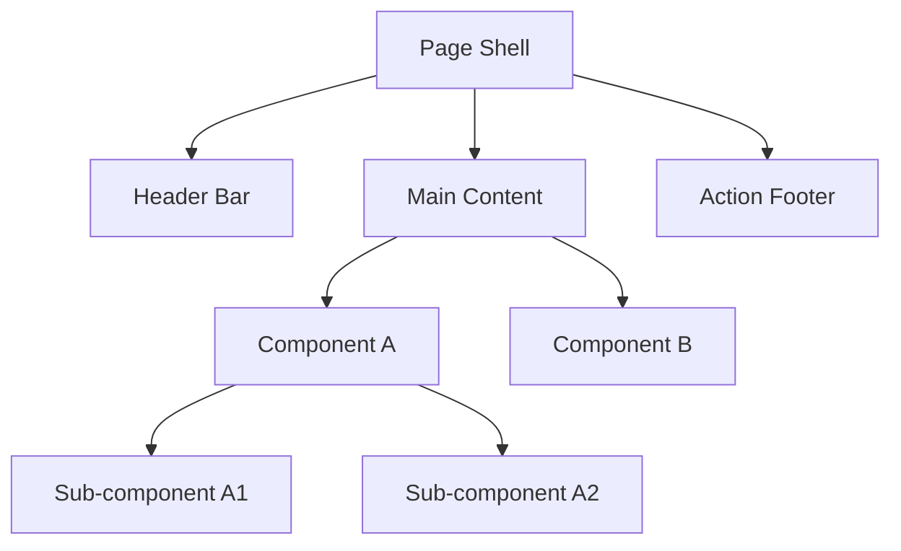
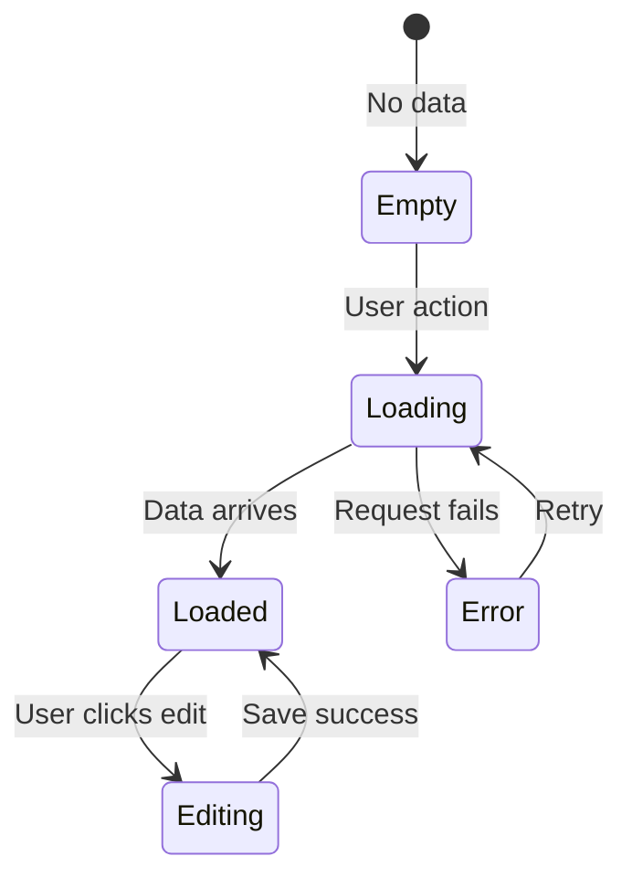

# Wireframe: [Feature Name]

**Date**: YYYY-MM-DD
**Feature**: [Feature name]
**Pitch plan**: `.project/pitches/{slug}/plan.md`
**Design reference**: [Path to the project's actual brand or design-system reference]

---

## Screen Layout

### Desktop (>= 1024px)

```
┌─ [Screen Name] ──────────────────────────────────────────────┐
│ ┌─ Header ─────────────────────────────────────────────────┐ │
│ │ [Title]                              [Action Button]     │ │
│ └──────────────────────────────────────────────────────────┘ │
│                                                              │
│ ┌─ Main Content ───────────────────────────────────────────┐ │
│ │                                                          │ │
│ │  [Component A]              [Component B]                │ │
│ │                                                          │ │
│ └──────────────────────────────────────────────────────────┘ │
│                                                              │
│ ┌─ Footer / Actions ──────────────────────────────────────┐ │
│ │ [Secondary Action]                    [Primary Action]   │ │
│ └──────────────────────────────────────────────────────────┘ │
└──────────────────────────────────────────────────────────────┘
```

### Tablet (768px – 1023px)

```
[Describe layout changes: stacked columns, hidden sidebar, etc.]
```

### Mobile (< 768px)

```
[Describe mobile layout: full-width, bottom sheet, etc.]
```

---

## Component Map



---

## State Transitions



---

## Interactive Elements

| Element | Type | Action | Feedback |
|---------|------|--------|----------|
| [Primary CTA] | Button | Submit form | Loading spinner → success toast |
| [List item] | Card | Navigate to detail | Hover: shadow-md, click: route change |
| [Filter] | Select | Filter list | Instant filter, no loading |
| [Delete] | Icon button | Confirm → delete | Dialog → success toast |

---

## Design Tokens Used

Replace bracketed token names with the implementation's actual names. Reference values are not an implemented theme.

| Token | Value | Usage |
|-------|-------|-------|
| [Primary token] | [Approved brand value] | Primary actions and active states |
| [Background token] | [Approved background value] | Page background |
| [Surface token] | [Approved surface value] | Card surfaces |
| [Text token] | [Size from the project's type scale] | Labels and metadata |
| [Shape token] | [Radius from the project's design system] | Card corners |

---

## Accessibility Notes

- [ ] All interactive elements have visible focus indicators
- [ ] Color is not the only way to convey information
- [ ] Touch targets are >= 44x44px on mobile
- [ ] Screen reader flow follows visual order
- [ ] ARIA labels on icon-only buttons

---

## Open Questions

- [ ] [Question about layout or interaction not yet decided]
